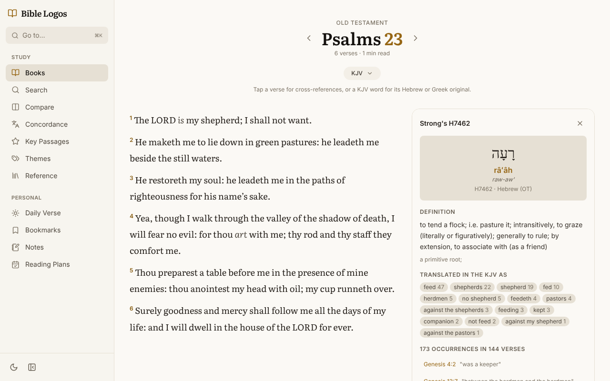
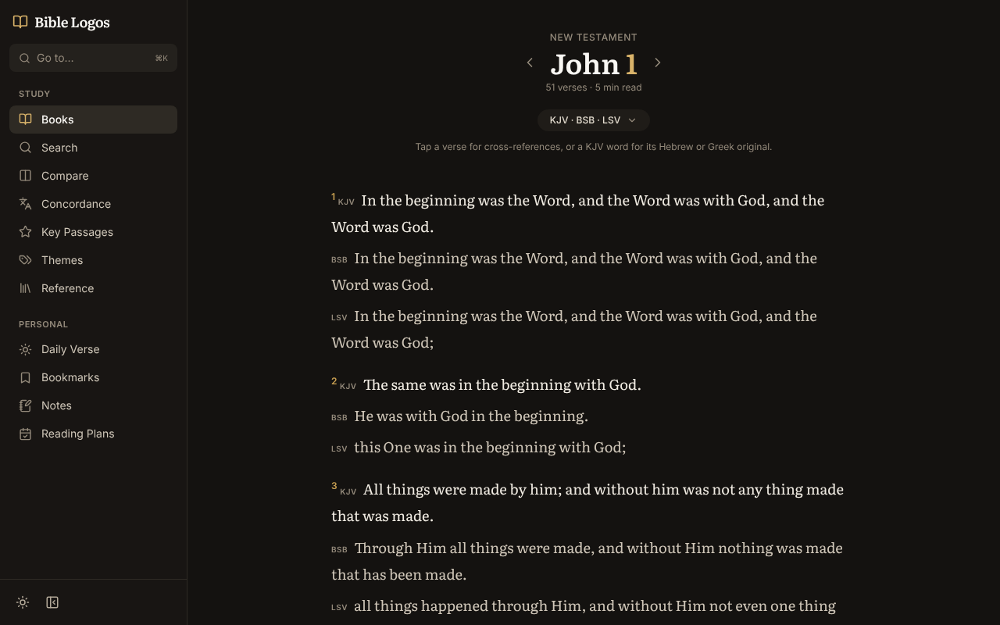
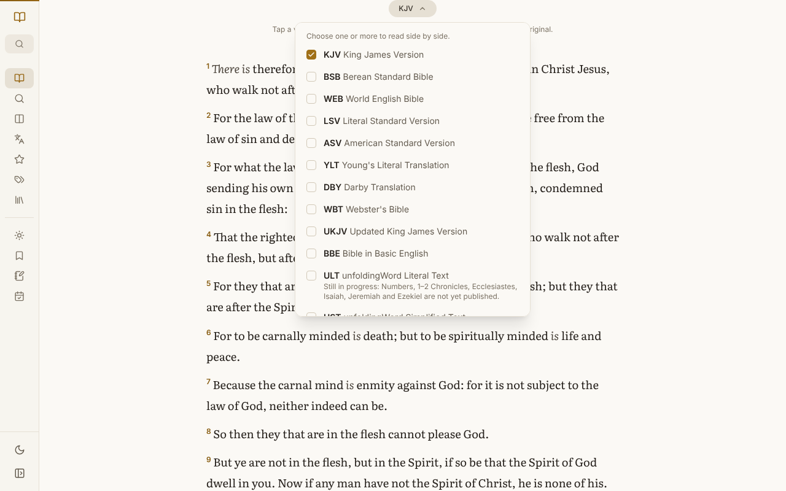
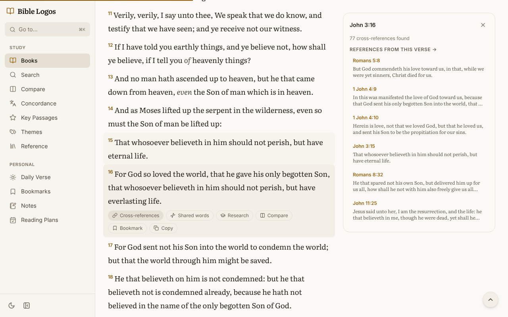
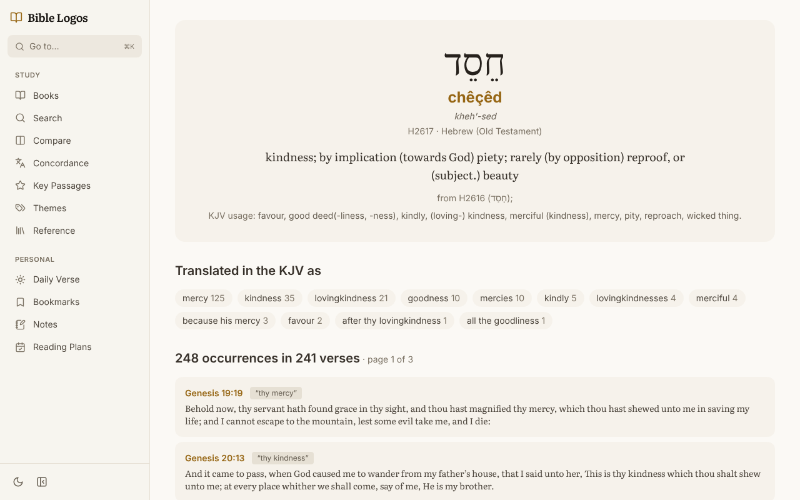
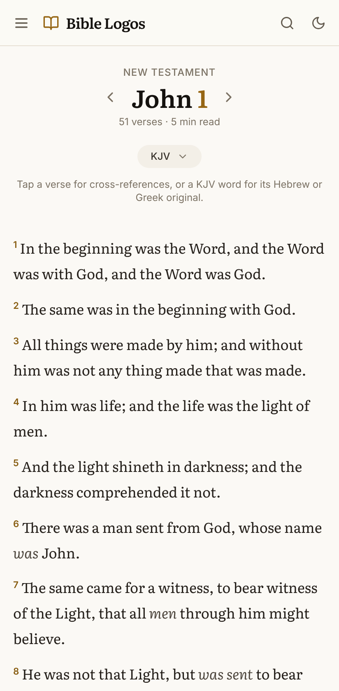

<div align="center">


# Bible Logos

**A simple but powerful tool for personal Bible study and research.**

Read 18 openly licensed translations side by side, open the Hebrew or Greek behind every word of the King James Version, and follow 430,000 cross-references, all on your own computer.

[](https://github.com/VictorOsondu/bible-logos/actions/workflows/ci.yml)
[](LICENSE)
[](https://nextjs.org)
[](https://www.typescriptlang.org)

[Features](#features) · [Translations](#translations) · [Getting started](#getting-started) · [Contributing](#contributing) · [Data sources](#data-sources)



</div>

> [!NOTE]
> **Bible Logos is a work in progress.** Not everything has been checked yet: some reference data, verse alignments between translations and features may contain mistakes. Please treat it as a study aid, check important points against a printed Bible, and [report anything that looks wrong](https://github.com/VictorOsondu/bible-logos/issues).

Bible Logos began as a fork of [BibleLens](https://github.com/quantumnic/biblelens) by Nicola Spieser. It downloads openly licensed texts and reference data once, keeps them in a local SQLite database, and gives you a fast, private study space in the browser. There are no accounts, no adverts and no tracking: your notes and bookmarks stay in your browser.

## Features

### The original languages, one click away

Every word of the King James Version is linked to its Hebrew or Greek original. Click a word to see the original script, transliteration, pronunciation and Strong's definition, how the KJV translates it elsewhere, and every verse where it occurs. Words the translators supplied are shown in *italics*, as in printed editions.

### Translations side by side

Choose any of the [18 translations](#translations) and read them verse by verse. Every translation is stored with the KJV's verse numbers, so they always line up, and each one's licence is credited beneath the text.

<table>
  <tr>
    <td width="50%"></td>
    <td width="50%"></td>
  </tr>
  <tr>
    <td align="center"><sub>Three translations together, in the dark theme</sub></td>
    <td align="center"><sub>Choosing translations, with the menu collapsed to icons</sub></td>
  </tr>
</table>

### Strong's concordance

The complete Strong's lexicon: 8,674 Hebrew and 5,523 Greek entries. Search by number (`H2617`, `G26`), by transliteration as you would naturally spell it (`chesed`, `agape`, `shalom`), by original script or by English meaning. Each entry shows how the KJV renders the word (*chesed*: mercy 125×, kindness 35×, lovingkindness 21×) and every verse it appears in.

### Cross-references and search

Tap any verse for its cross-references from the OpenBible.info dataset, ranked by relevance, along with verses that share its key words, related research and a link to compare every translation. Full-text search covers every translation and understands phrases and partial words.

<table>
  <tr>
    <td width="50%"></td>
    <td width="50%"></td>
  </tr>
  <tr>
    <td align="center"><sub>Cross-references for John 3:16</sub></td>
    <td align="center"><sub>A Strong's entry: <i>chesed</i>, H2617</sub></td>
  </tr>
</table>

### Personal study

- Pick up where you left off: the home page remembers the last chapter you read.
- Bookmarks, reading history, study notes and reading plans, all kept in your browser.
- Key Passages: the Beatitudes, the Lord's Prayer, the Ten Commandments, and the Bible's songs and doxologies.
- Reference indexes of parables, miracles, prophecies, covenants, people, places, names of God and more, each linking straight to the verses.

### Designed for reading



A calm, uncluttered layout that puts the text first:

- Light and dark themes, following your device unless you choose.
- Works as well on a phone as on a desktop, with study tools in a sheet that slides up from the bottom.
- On wider screens the menu collapses to icons for more reading space.
- Everything works by keyboard: <kbd>⌘K</kbd> or <kbd>Ctrl K</kbd> jumps to any verse or page, <kbd>←</kbd> and <kbd>→</kbd> move between chapters, and <kbd>Esc</kbd> closes a panel.

<br clear="right">

## Translations

**Every translation in Bible Logos is in the public domain or under an open licence**, so it can be read, shared and studied freely.

| Code | Translation | Licence | Notes |
|---|---|---|---|
| KJV | King James Version, with Strong's numbers | Public domain (Crown patent in the UK) | Every word linked to the Hebrew or Greek |
| BSB | Berean Standard Bible | Public domain | |
| WEB | World English Bible | Public domain | |
| LSV | Literal Standard Version | CC BY-SA 4.0, © Covenant Press | |
| ASV | American Standard Version | Public domain | |
| YLT | Young's Literal Translation | Public domain | |
| DBY | Darby Translation | Public domain | |
| WBT | Webster's Bible | Public domain | |
| UKJV | Updated King James Version | Public domain | |
| BBE | Bible in Basic English | Public domain | |
| ULT | unfoldingWord® Literal Text | CC BY-SA 4.0, unfoldingWord | In progress: Numbers, 1–2 Chronicles, Ecclesiastes, Isaiah, Jeremiah and Ezekiel not yet published |
| UST | unfoldingWord® Simplified Text | CC BY-SA 4.0, unfoldingWord | As for the ULT; words in {braces} are implied by the original |
| OEB | Open English Bible | Public domain (CC0) | In progress: parts of the Old Testament not yet translated |
| WMB | World Messianic Bible | Public domain (the name is a trademark) | The World English Bible with Hebrew forms of names |
| JPS | Jewish Publication Society Tanakh (1917) | Public domain | Hebrew Scriptures only; renumbered to the English verse numbers |
| CPDV | Catholic Public Domain Version | Public domain | Psalms numbered as in the Latin Vulgate |
| WYC | Wycliffe Bible | Public domain | Middle English; Psalms numbered as in the Latin Vulgate |
| VUL | Latin Vulgate | Public domain | |

Only the 66 books of the Protestant canon are included for now.

## Getting started

You need [Node.js](https://nodejs.org) 20.9 or later.

```bash
git clone https://github.com/VictorOsondu/bible-logos.git
cd bible-logos
npm install
npm run seed   # downloads the texts and builds data/bible.db (about 220 MB, a minute or two)
npm run dev    # then open http://localhost:3000
```

Run `npm run seed` again at any time to rebuild the database. Downloads are kept in `data/sources/`, so later runs are quicker.

### Running with Docker

The Docker image seeds the database and builds the app in one step:

```bash
docker build -t bible-logos .
docker run -p 3000:3000 bible-logos
```

The image runs as a non-root user and contains only the standalone server, its static files and the read-only database. `GET /api/health` returns `200 {"status":"ok"}` when the database can be read (and `503` otherwise), and the image uses it as its health check.

<details>
<summary><b>Notes for running it on a server</b></summary>

- **Security headers:** a Content Security Policy, `X-Frame-Options: DENY`, `nosniff`, a strict referrer policy and a permissions policy are set in `next.config.js`. Set HSTS wherever HTTPS is terminated. Scripts still need `'unsafe-inline'` for the data Next.js inlines into each page.
- **Research API:** `/api/research` caches results for a day and is rate-limited (20 requests a minute per client, 120 overall). Limits are held in memory, so they apply per server process. Behind a proxy, make sure it sets `X-Forwarded-For`.
- **Telemetry:** set `NEXT_TELEMETRY_DISABLED=1` to stop Next.js sending anonymous usage data (the image and CI already do).

</details>

## Contributing

Corrections and contributions are very welcome. Reports of mistakes in the text or data are especially valuable while the project is a work in progress. Please read [CONTRIBUTING.md](CONTRIBUTING.md) first: it covers the rules for content (open licences only, every source credited, a translation's wording never changed), setting up, and the checks to run.

| Command | Purpose |
|---|---|
| `npm run dev` | Development server |
| `npm run typecheck` | Type-check with TypeScript |
| `npm run lint` | Lint with ESLint |
| `npm test` | Unit tests (Vitest); `npm run test:coverage` adds a coverage report |
| `npm run test:e2e` | Browser tests (Playwright) against a production build; run `npx playwright install chromium` once first |
| `npm run build && npm start` | Production build; stops early if `data/bible.db` is missing |
| `npm run screenshots` | Retakes the screenshots in this README from a running server |

CI runs the type check, lint, unit tests, a full seed and build, and the browser tests on every push and pull request. Dependabot proposes dependency updates weekly.

## Data sources

The seed script downloads everything below; none of it is stored in this repository. Each download is pinned to an exact commit or release and checked against a SHA-256 hash in `scripts/sources.ts`, so the database is the same on every machine. To update a source, change its URL and hash there; the seed reports the hash it received when they differ.

| Source | Used for | Licence |
|---|---|---|
| [CrossWire Bible Society KJV module](https://gitlab.com/crosswire-bible-society/kjv) | KJV text with Strong's numbers and Greek morphology | Text public domain; module markup GPL |
| [Open Scriptures Strong's dictionaries](https://github.com/openscriptures/strongs) | Hebrew and Greek lexicon | CC BY-SA |
| [scrollmapper/bible_databases](https://github.com/scrollmapper/bible_databases) | BSB, ASV, YLT, Webster, UKJV, BBE, OEB, JPS, CPDV, Wycliffe and Vulgate texts | See [Translations](#translations) |
| [seven1m/open-bibles](https://github.com/seven1m/open-bibles) | World English Bible and Darby texts | Public domain |
| [wldeh/bible-api](https://github.com/wldeh/bible-api) | Literal Standard Version text | CC BY-SA 4.0 |
| [unfoldingWord on Door43](https://git.door43.org/unfoldingWord) (release v91) | ULT and UST texts | CC BY-SA 4.0 |
| [eBible.org](https://ebible.org/Scriptures/details.php?id=engwmb) | World Messianic Bible text | Public domain |
| [BibleNLP/ebible](https://github.com/BibleNLP/ebible) | English–Hebrew verse number mapping (Paratext `eng.vrs`), used to renumber the JPS | Reference data (verse numbers only) |
| [OpenBible.info](https://www.openbible.info/labs/cross-references/) (via scrollmapper) | Cross-references | CC BY |
| [Semantic Scholar](https://www.semanticscholar.org/), [PubMed](https://pubmed.ncbi.nlm.nih.gov/), [Open Library](https://openlibrary.org/) | Live research results | Queried on demand |

eBible.org does not version its files. If it publishes an update to the World Messianic Bible, the seed leaves the WMB out (with a warning) until its hash in `scripts/sources.ts` is refreshed, rather than failing.

## How it is built

- **Next.js 16** (App Router) with **React 19**, **TypeScript** and **Tailwind CSS 4**.
- **SQLite** via `better-sqlite3`, read-only at run time, with an FTS5 full-text index.
- `scripts/seed.ts` builds the database. `scripts/download.ts` fetches and verifies the sources, `scripts/bibles.ts` reads each Bible format (JSON, Zefania, USFX and USFM) and renumbers Hebrew verse numbers, and `scripts/kjv-strongs.ts` parses the Strong's lexicon and the tagged KJV.
- `src/lib/translations.ts` lists the translations with their licences and notes; `src/lib/strongs.ts` holds the Strong's queries; `src/lib/navigation.ts` lists the app's pages.
- Fixed reference pages are pre-rendered at build time; the reader is rendered on request.

## Credits

Bible Logos began as a fork of **[BibleLens](https://github.com/quantumnic/biblelens)** by Nicola Spieser, released under the MIT licence. Thank you for the foundation.

Strong's data: James Strong (1890/1894); JSON edition by Open Scriptures. Tagged KJV: CrossWire Bible Society, with Old Testament Strong's numbers from The Bible Foundation and New Testament data from the KJV2003 Project. Thanks also to everyone who publishes Bible texts under open licences, and to the projects listed under [Data sources](#data-sources).

## Licence

The code is released under the MIT licence; see [LICENSE](LICENSE). Bible texts and datasets keep their own licences, as listed above.

*Bible Logos presents the text and its sources; the conclusions are yours.*
